# Reach

Use your Mac from your iPhone, from anywhere.

  

Reach streams your Mac's screen to your iPhone and sends your touches and typing back, so the Mac
feels like it's in your hand. It's two apps: **Reach Host**, a menu-bar app on the Mac, and **Reach**
on the iPhone. Video and input travel peer-to-peer over WebRTC with hardware HEVC/H.264 encoding, and
a session carries on when the iPhone switches between Wi-Fi and cellular.

> [!NOTE]
> Reach is early and experimental, and hasn't had an independent security audit. Read
> [Known limitations](#known-limitations) before relying on it.

## How it works

1. **Pair once.** Reach Host shows a QR code. Scan it with the iPhone and the two devices remember
   each other's keys. There's no account to create.
2. **Connect from anywhere.** The devices find each other through two public relays that only see
   encrypted envelopes, then connect directly: same Wi-Fi, IPv6, or through NATs. If both networks
   are strict, an optional TURN server you run bridges the gap.
3. **Use your Mac.** Drag to move the pointer, tap to click, pinch to zoom, and type with the iPhone
   keyboard, with Esc, Tab, modifiers and arrow keys above it. Clipboard, app switching and Mission
   Control come along too.

The full design is in [docs/DESIGN.md](docs/DESIGN.md).

## Requirements

- A Mac with macOS 14 or later
- An iPhone with iOS 18 or later
- Xcode 26 or later, and an Apple developer account to sign the apps

## Build and run

1. Clone the repository and open `Reach.xcodeproj`. Xcode downloads the WebRTC framework on the
   first build.
2. Copy `Config/Local.xcconfig.example` to `Config/Local.xcconfig` and fill in your team ID and a
   bundle identifier prefix you own. The file is git-ignored.
3. Run **ReachHost** on your Mac. Its onboarding asks for **Screen Recording** (to stream the screen)
   and **Accessibility** (to send input).
4. Run **Reach** on your iPhone, choose *Pair*, and scan the code from **Pair iPhone…** in Reach
   Host's menu.

To unpair, remove the iPhone from the device list in Reach Host's menu. On the iPhone, *Forget Mac*
removes the Mac.

Set up a TURN server

When both devices sit behind restrictive NATs, a direct connection can fail. Run a TURN server (for
example [coturn](https://github.com/coturn/coturn)) and enter its address and credentials in Reach
Host's settings. Paired iPhones pick it up the next time they check on the Mac; if a connection fails
right after you add it, try again.

Develop

- The Xcode project is generated from `project.yml` with
  [XcodeGen](https://github.com/yonaskolb/XcodeGen). After changing `project.yml`, run
  `xcodegen generate`.
- `"Reach Host.app/Contents/MacOS/Reach Host" --self-test` runs the host's built-in checks.
- `Packages/ReachKit` includes `reach-probe`, a command-line host and client for end-to-end tests,
  and a latency benchmark. See [Tools/README-bench.md](Tools/README-bench.md).
- The illustration above is generated by `python3 Tools/make-hero.py`.

## Known limitations

- **Public relays.** Connections are set up through ntfy.sh and HiveMQ's public test broker. They
  can't read or forge messages, but they can see that two devices exchange a few messages, and when.
  If both relays are down, Reach can't connect. There's no option yet to use your own.
- **Replay window after a restart.** Setup messages are timestamped (±5 minutes) and de-duplicated
  in memory, so a captured message could be replayed within that window after the receiving app
  restarts. It still can't complete a connection without the device's private key.
- **No forward secrecy for setup messages.** They're encrypted with keys derived from the two
  devices' long-term identity keys. Someone who records relay traffic and later steals one of those
  keys could read past setup messages: network addresses, device names and TURN settings. Video and
  input travel over WebRTC's DTLS, which has forward secrecy.
- **One session at a time.** Connecting from a second paired iPhone ends the first session.
- **Thin automated tests.** Most coverage is the host self-test and `reach-probe`.

## Security

Please report vulnerabilities privately, as described in [SECURITY.md](SECURITY.md).

## License

MIT, see [LICENSE](LICENSE). App builds include WebRTC under its own license; see
[THIRD_PARTY_NOTICES.md](THIRD_PARTY_NOTICES.md).
